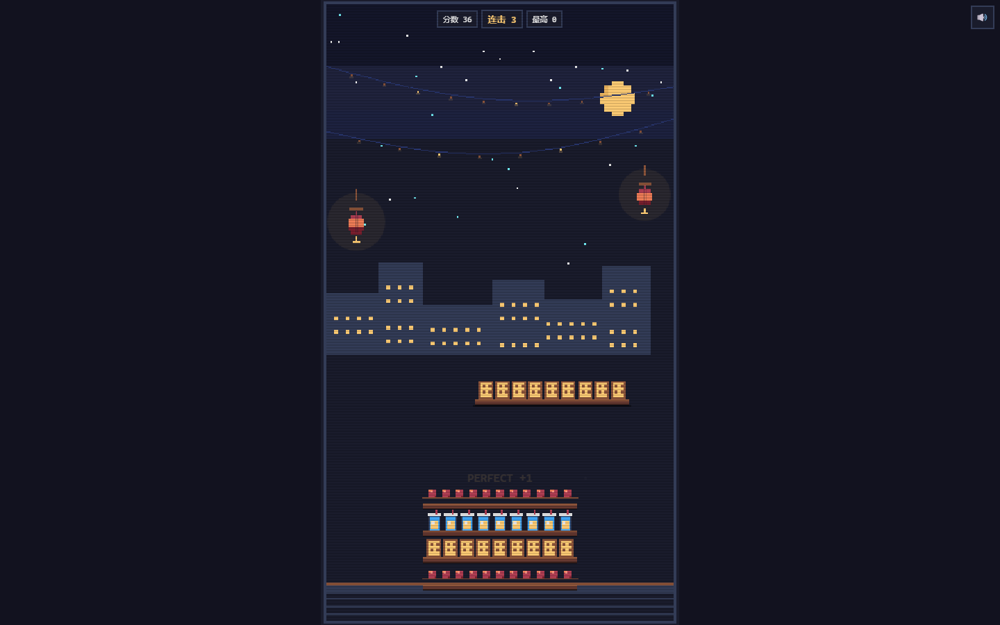
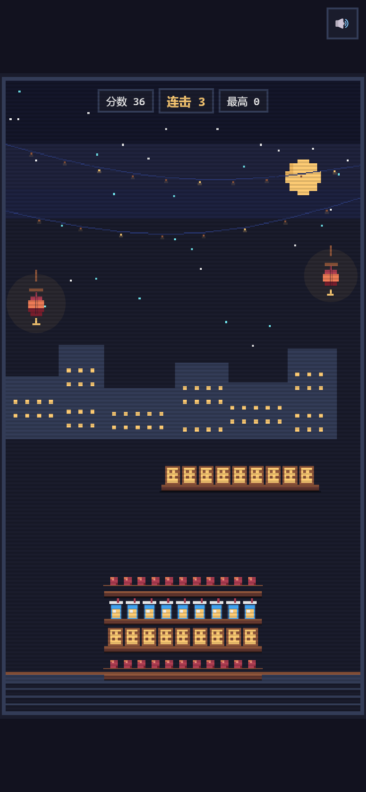

# 夜市叠叠高 · 6 天冲刺计划（5 天做完 + 第 6 天面试）

> 从 0 到 GitHub Pages：5 天做出可玩版本，第 6 天只准备简历与面试。  
> 适用：会一点 HTML/JS、想用 AI coding 做出第一个作品集项目的学生。  
> 每天 4~6 小时；5 个“学习日”，不是 5 个自然日；如果每天只有 2 小时，按第 7 节的“最低完成线”砍。  
> 原则：**先做完，再做好；每天只做当天的事，不提前堆功能。**

---

## 0. 这份文档怎么用

1. **每天只看当天的章节**，做完打勾，不要提前看后面。
2. 每天结束时写 3 行 `DEVLOG.md`：今天做了什么、遇到什么、明天第一件事。
3. 每天结束必须 `git commit` 一次，commit message 按文档里的命名。
4. 任何“想加的新功能”先写进 `IDEAS.md`，**v1.0 之前不实现**。
5. 如果某天没做完：砍功能，不要熬夜补；第二天先补验收，再往前走。
6. 遇到报错：先复制报错原文，再让 AI 解释；不要只说“不行”。

---

## 1. 项目目标与非目标

### 目标（v1.0 必须全部满足）

- 一个可玩的 H5 休闲游戏，手机竖屏优先，一局约 3 分钟。
- 公开的 GitHub Pages 链接，别人点开就能玩。
- 一份能看懂的 `README.md`、一份 `DEVLOG.md`、一组无头测试。
- 你能在面试里用 3 分钟讲清楚：玩法、技术、难点、验证。
- 所有代码、美术、音效原创，或使用 CC0/MIT 素材并署名。

### 非目标（v1.0 之前不做）

- 不做排行榜、账号、登录、内购、广告、多人。
- 不做 3D、不做复杂物理引擎、不做关卡编辑器。
- 不追求“像某个 Poki 游戏”；只借鉴核心循环，表达层全部原创。
- 不抄任何原游戏的代码、图片、音乐、文案、关卡。
- 不把“AI 生成”当成“我做的”；你要能解释每一行。

---

## 2. 红线（公开到 GitHub 之前必须确认）

- [ ] 仓库里没有 Poki 或任何原游戏的包体、原图、原代码、原关卡。
- [ ] 没有使用原游戏的名字、角色、logo、商标。
- [ ] 没有写“Poki 开源”“官方”“正版”等误导性描述。
- [ ] 美术/音效要么原创，要么 CC0/MIT/CC-BY 并写进 `CREDITS.md`。
- [ ] 仓库有 `LICENSE`（代码用 MIT）和免责声明。
- [ ] 不上架、不商用、不二次分发任何原素材。
- [ ] 面试时讲“品类研究 / clean-room 实现”，不讲“破解/换皮搬运”。

---

## 3. 技术栈与工具

| 用途 | 选择 | 说明 |
|---|---|---|
| 页面 | HTML + CSS | 单文件起步，后面可拆 |
| 逻辑 | 原生 JavaScript（vanilla JS） | 不引入框架，避免依赖 |
| 画面 | Canvas 2D | 2D 游戏足够 |
| 声音 | WebAudio | 代码合成，不用 mp3 |
| 存档 | localStorage | 只存最高分/静音设置 |
| 测试 | Node.js | 无头测试，不开浏览器 |
| 版本 | Git + GitHub | 每天 commit |
| 发布 | GitHub Pages | 免费静态托管 |
| 编辑器 | VS Code | 装 Live Server 可选 |

**安装检查（Day 1 做）：**

```bash
node -v
git --version
```

两个命令都能输出版本号即可。没有 Node 就去 nodejs.org 装 LTS；没有 Git 就去 git-scm.com 装。

---

## 4. 最终文件结构

```text
夜市叠叠高/
├── index.html          # 游戏入口（v0.1 单文件）
├── logic.js            # Day 4 抽出的纯逻辑（判定/计分）
├── SPEC.md             # 玩法规格
├── DEVLOG.md           # 开发日志
├── IDEAS.md            # 想做但 v1.0 不做的功能
├── README.md           # 仓库说明书
├── LICENSE             # MIT
├── CREDITS.md          # 素材来源
├── tests/
│   └── smoke.test.js   # 无头测试
├── screenshots/
│   ├── desktop.png
│   └── mobile.png
└── docs/
    └── case-study.md   # 作品集案例（可选）
```

v0.1 只需要 `index.html`、`SPEC.md`、`DEVLOG.md`、`IDEAS.md`。

---

## 5. 游戏 SPEC（复制成 `SPEC.md`）

```markdown
# SPEC · 夜市叠叠高

## 一句话
点击让夜市小吃落下，叠得越高分越高；完美对齐触发连击。

## 核心循环
观察 → 点击 → 落下 → 判定 → 反馈 → 难度上升

## 第一版数值
- 画布逻辑尺寸：360 × 640（9:16）
- 每块高度：28px
- 初始宽度：120px
- 初始速度：120px/s；每层 +4；上限 360
- perfect：中心偏差 ≤ 8px
- 失败：重叠 < 10px
- 连击：perfect +1，普通归零；倍率 1 + combo×0.1，上限 3
- 最高分：localStorage

## MVP 必须
移动、点击落下、重叠判定、切割、分数、连击、失败、重开、最高分

## 可砍
皮肤、排行榜、分享、成就、每日挑战、登录、广告

## 美术
第一版纯色矩形；第二版 Canvas 画包子/串串/奶茶杯；霓虹夜市背景；全部原创

## 音效
WebAudio 合成：落下、perfect、失败；不引入 mp3

## 验收
- 手机竖屏可玩，60FPS
- 一局 30~60 次点击，约 3 分钟
- 无头测试 100 次点击通过
- 包体 < 200KB
```

---

## 6. 总体路线图

| 阶段 | 天数 | 目标 | 版本 | 关键产物 |
|---|---|---|---|---|
| 1 核心循环 | Day 1 | 能玩 | v0.1 | `index.html` 能跑 |
| 2 手感/音效 | Day 2 | 爽 | v0.2 | 顿帧、震屏、粒子、音效 |
| 3 美术/移动端 | Day 3 | 好看、手机能玩 | v0.3 | 夜市背景、小吃、触控 |
| 4 测试/稳定 | Day 4 | 稳 | v0.4 | `logic.js`、测试、README 草稿 |
| 5 发布/试玩 | Day 5 | 上线 | v1.0 | GitHub Pages、5 人试玩 |
| 6 面试/作品集 | Day 6 | 能投 | v1.0 | 简历、3 分钟陈述、case study |

---

## 7. 六天冲刺计划（5 天做完 + 第 6 天面试）

> 5 天把游戏做到“能公开玩”，第 6 天只做简历、面试、作品集，不再改玩法。  
> 每天按 4~6 小时设计；如果每天只有 2 小时，看每节末尾的“最低完成线”。

### 5 天版必须砍掉什么

先接受取舍，否则 5 天做不完：

- ❌ 皮肤系统、排行榜、账号、登录、内购、广告、每日挑战、分享。
- ❌ 复杂粒子、BGM、多语言、精细逐帧动画。
- ❌ E2E 测试（只做无头逻辑测试）。
- ❌ 正式用户调研（只找 3~5 人试玩）。
- ❌ 个人作品集网站（只做 GitHub README + 一份 case study；网站以后补）。
- ❌ 任何“等我有空再加”的功能。

**5 天版只保留：核心循环 + 手感 + 4 个音效 + 简单夜市美术 + 手机能玩 + 逻辑测试 + GitHub Pages。**

### Day 1 · v0.1 核心循环（4~6 小时）

**目标**：从零到“能玩”，并把 Git 建起来。

**任务**
- [x] 1 小时：建文件夹 `夜市叠叠高`；写 `SPEC.md`、`DEVLOG.md`、`IDEAS.md`；`git init`；检查 `node -v`、`git --version`。
- [x] 2 小时：新建 `index.html`，复制附录 A 骨架；双击打开，点“开始”，点屏幕落块。
- [x] 1 小时：玩 10 局，只修 3 个“影响能不能玩”的问题（比如点不动、不能重开、分数不对）。
- [x] 0.5 小时：更新 `DEVLOG.md`，commit：`v0.1: 核心循环`。

**产出**：纯色矩形的可玩版本 + 第一次 commit。

**验收**
- [x] 能开始、能落块、能计分、能失败、能重开。
- [x] 刷新后最高分还在。
- [x] 控制台无红色报错。

**最低完成线（每天只有 2 小时）**：只做“复制骨架 → 能跑 → 能重开”，问题记录到 DEVLOG，明天再修。

**AI Prompt（卡住时用）**
> “我用 vanilla JS + Canvas 写了一个叠叠乐。现象是：______。请先解释根因，再给我最小修改；不要重写整个文件。”

**不要做**：美术、音效、排行榜、皮肤。

---

### Day 2 · v0.2 手感 + 音效（4~6 小时）

**目标**：让 perfect 和普通“感觉不一样”，并加上 4 个合成音效。

**任务**
- [x] 2 小时：perfect 闪白 80ms + `PERFECT +1` 浮动文字 + 轻震 120ms；普通 `+5`；失败重震 + 红闪；粒子最多 20 个。
- [x] 1.5 小时：WebAudio 合成 4 个音效（落下、perfect、失败、连击）；第一次 `pointerdown` 创建 `AudioContext`；静音按钮存 `localStorage`。
- [x] 1 小时：玩 20 局，只调 `CONFIG` 数值（速度、perfect 窗口、失败阈值），不改逻辑。
- [x] 0.5 小时：commit：`v0.2: 手感与音效`。

**产出**：有反馈、有声音的 v0.2。

**验收**
- [x] perfect 和普通一眼能区分。
- [x] 音效正常，没有自动播放报错；静音刷新后保持。
- [x] 玩法数值没有被特效影响；60FPS。

**最低完成线**：只做 perfect 闪白 + 1 个音效；其余明天补。

**AI Prompt**
> “只加手感，不改玩法：perfect 闪白 + 浮动文字 + 轻震；普通 +5；失败重震 + 红闪。特效随机用 fxR()，玩法随机保持 Math.random()。给我最小 diff。”

**不要做**：美术、新机制、BGM（除非 Day 1~2 提前完成）。

---

### Day 3 · v0.3 美术 + 移动端（4~6 小时）

**目标**：看起来像“夜市游戏”，手机上能顺畅玩。

**任务**
- [x] 2 小时：深紫/深蓝渐变背景 + 2 盏灯笼 + 3 种小吃（糖葫芦、鸡蛋仔、冰柠檬茶）的 Canvas 绘制函数；碰撞盒不变。
- [x] 1 小时：开始/结束界面统一风格；连击数字加大；少量粒子。
- [ ] 1.5 小时：手机适配——`viewport`、`touch-action: none`、安全区、点击延迟；真机玩 5 局。
- [x] 0.5 小时：commit：`v0.3: 夜市美术与移动端`；用户选定 A 组后再提交 `v0.3.1: A 组小吃重绘`。

**产出**：有主题、手机能玩的 v0.3。

**验收**
- [x] 一眼能看出“夜市”；3 种小吃能区分。
- [ ] 手机不滚动、不缩放、刘海不挡 HUD；60FPS。
- [x] 没有使用任何原游戏素材。

**最低完成线**：只做背景渐变 + 1 种小吃；手机能点就行。

**AI Prompt**
> “把矩形换成三种小吃的 Canvas 绘制函数：包子、串串、奶茶杯；碰撞盒和逻辑不变；背景加霓虹渐变和灯笼。先给绘制函数，不要改玩法。”

**不要做**：皮肤系统、设置页、逐帧动画。

---

### Day 4 · v0.4 测试 + 稳定（4~6 小时）

**目标**：逻辑可测、bug 收敛、README 有草稿。

**启动前基线（已完成准备）**
- [x] 从干净的 `v0.3.1` 提交 `6e7738e` 开始，保留 `versions/v0.3.1.html`。
- [x] 冻结玩法参数：初始宽度 160、速度 100/+3/上限 300、PERFECT 12、失败重叠 10。
- [x] 记录浏览器基线：手机视口约 60.04 FPS，20 局平均 30.75 次点击，无页面错误。
- [ ] 用户真实手机试玩 5 局并反馈触控、刘海、音量与震屏。

**任务**
- [ ] 2 小时：把 `overlap()`、`judge()`、`scoreFor()` 抽到 `logic.js`（UMD 写法，同时支持浏览器和 Node）；`index.html` 引入。
- [ ] 1.5 小时：写 `tests/smoke.test.js`，覆盖 6 件事：重叠、perfect、普通、连击、失败、重开；`node tests/smoke.test.js` 全绿。
- [ ] 1 小时：让 AI 做 code review，只修 top 3。
- [ ] 0.5 小时：写 `README.md` 草稿 + `CREDITS.md`；commit：`v0.4: 测试与稳定`。

**产出**：测试通过、bug 收敛的 v0.4。

**验收**
- [ ] 测试连续跑 3 次结果一致。
- [ ] 故意改坏一个判定，测试能报错。
- [ ] 没有已知的致命 bug。

**最低完成线**：只测“重叠 + perfect + 失败”3 件事；README 先写 5 行。

**AI Prompt**
> “把叠叠乐的 overlap/judge/scoreFor 抽成纯函数，放到 logic.js，用 UMD 写法同时支持浏览器和 Node；写 tests/smoke.test.js，覆盖重叠、perfect、普通、连击、失败、重开；不要依赖浏览器 API。”

**不要做**：E2E、全面重构、新功能。

---

### Day 5 · 发布 + 5 人试玩 + v1.0（4~6 小时）

**目标**：拿到公开链接，让真人试玩，修完 top 3，打 v1.0。

**任务**
- [ ] 1.5 小时：GitHub 新建 public 仓库 → push → Settings → Pages → 打开公开链接；README 写链接；加 `LICENSE`（MIT）、`CREDITS.md`、免责声明。
- [ ] 1 小时：截桌面 + 手机图，录 5~8 秒 GIF，放 `screenshots/`。
- [ ] 1.5 小时：找 3~5 个同学/朋友试玩，**不要先解释玩法**；观察前 30 秒；记录 top 3 问题。
- [ ] 1 小时：只修 top 3（影响“能不能玩”的），push。
- [ ] 0.5 小时：`git tag v1.0`；更新 `DEVLOG.md`。

**产出**：公开可玩的 v1.0。

**验收**
- [ ] 桌面和手机都能打开；没有 404/控制台报错。
- [ ] 3~5 人里至少 4 人能自己开始玩。
- [ ] 仓库没有原游戏素材；README 链接可点。

**最低完成线**：只部署 + 找 3 人试玩；top 3 里只修 1 个最致命的。

**AI Prompt**
> “这是 3 条试玩反馈：______。按影响排序，只修 top 3；不要加新功能；给我最小 diff。”

**不要做**：按反馈加排行榜/皮肤；重做美术；改玩法。

---

### Day 6 · 面试 + 作品集（4~6 小时，不改玩法）

**目标**：把项目变成简历、3 分钟陈述、case study。**今天只写材料，不加功能。**

**任务**
- [ ] 1 小时：写 2~3 条简历 bullet（见第 13 节）。
- [ ] 1 小时：写 3 分钟面试陈述 + 5 个常见问题答法；对着手机录一遍。
- [ ] 1.5 小时：写 `docs/case-study.md`：目标、玩法、技术、难点、验证、局限。
- [ ] 1 小时：README 定稿（链接、截图、GIF、技术栈、License、免责声明）；把项目放到简历/作品集。
- [ ] 0.5 小时：最后检查仓库：`LICENSE`、`CREDITS`、免责声明、无原素材；`git tag v1.0` 已推。
- [ ] 0.5 小时：找朋友/AI 做一次模拟面试，计时 3 分钟。

**产出**：简历 bullet + 3 分钟陈述 + case study + 干净仓库。

**验收**
- [ ] 3 分钟能不看稿讲完。
- [ ] 每个数字都是真的；没有“千万用户”这类编造。
- [ ] 5 个问题都能诚实回答。
- [ ] 仓库 `git status` 干净。

**最低完成线**：只写简历 bullet + 3 分钟陈述；case study 先写 5 行提纲。

**AI Prompt**
> “把这段项目经历写成：① 2~3 条简历 bullet；② 3 分钟面试陈述；③ 5 个可能被问的问题和诚实答法。不要夸大，不要编数据。”

**不要做**：加功能、改玩法、换美术、开 v1.1。

---

### 每天固定收尾（20 分钟）

- [ ] 玩 5 局，确认今天没把游戏改坏。
- [ ] 写 3 行 `DEVLOG.md`。
- [ ] `git commit`，message 按当天版本。
- [ ] 写下明天第一件事。

### 如果每天只有 2 小时

按这个顺序砍，不要平均用力：

1. Day 1 只做核心循环，问题留给 Day 2。
2. Day 2 只做 perfect 闪白 + 1 个音效。
3. Day 3 只做背景渐变 + 1 种小吃 + 手机能点。
4. Day 4 只测 3 件事，README 写 5 行。
5. Day 5 只部署 + 找 3 人试玩，top 3 只修 1 个。
6. Day 6 只写简历 bullet + 3 分钟陈述。

### 5 天版最低完成线（一句话）

**能玩的公开链接 + 3 人试玩 + 一份 README + 3 条简历 bullet。**  
其余都是加分项，不是必须项。

---

## 8. AI Prompt 库（直接复制改空）

### 8.1 拆架构（不写代码）

> “先不要写代码。你是资深 H5 游戏工程师。我的玩法是：______。请把它拆成状态机、数据结构、渲染层、输入层、音效层；列出 MVP 和可砍功能；用表格输出。”

### 8.2 写 MVP

> “用 vanilla JS + Canvas 实现 MVP，单文件 index.html，移动端 touch 优先，零依赖。先只做核心循环：生成、移动、落下、判定、分数、失败、重开。代码分函数，关键处注释，不要做美术。”

### 8.3 只修一个 bug

> “这是当前代码：______。现象是：______。请先解释根因，再给最小修改；不要重写整个文件，不要改其他逻辑。”

### 8.4 只加手感

> “只加手感，不改玩法：perfect 闪白 + 浮动文字 + 轻震；普通 +5；失败重震 + 红闪。特效随机用 fxR()，玩法随机保持 Math.random()。给我最小 diff。”

### 8.5 加音效

> “用 WebAudio 合成 4 个音效：落下、perfect、失败、连击上升。第一次 pointerdown 创建 AudioContext；加静音按钮并存 localStorage；不要引入音频文件。”

### 8.6 加美术

> “把矩形换成三种小吃的 Canvas 绘制函数：包子、串串、奶茶杯；碰撞盒和逻辑不变；背景加霓虹渐变和灯笼。先给绘制函数，不要改玩法。”

### 8.7 移动端适配

> “检查移动端：touch-action、viewport、安全区、点击延迟、滚动缩放；给出最小修改；不要改玩法。”

### 8.8 写测试

> “把 overlap/judge/scoreFor 抽成纯函数，放到 logic.js，UMD 写法同时支持浏览器和 Node；写 tests/smoke.test.js，覆盖重叠、perfect、计分、失败；不要依赖浏览器 API。”

### 8.9 Code Review

> “做 code review：找 bug、性能问题、移动端适配问题；按严重度排序；只给问题和修法，不要重写全文。”

### 8.10 写 README / 简历

> “把这段项目经历写成：① README；② 3 条简历 bullet；③ 3 分钟面试陈述；④ 5 个可能被问的问题和诚实答法。不要夸大，不要编数据。”

---

## 9. 每日验收清单（通用）

每天结束前逐条检查：

- [ ] 游戏能打开，控制台无红色报错。
- [ ] 核心循环完整：能开始、能玩、能失败、能重开。
- [ ] 手机上能点、不滚动、不缩放。
- [ ] 没有新增当天计划外的功能。
- [ ] `DEVLOG.md` 写了 3 行。
- [ ] `git commit` 完成，message 符合规范。
- [ ] 明天第一件事写下来了。

---

## 10. 测试清单（Day 4 之后每天跑）

### 逻辑测试（Node）

- [ ] 两个矩形完全重合，overlap = 宽度。
- [ ] 两个矩形完全错开，overlap ≤ 0。
- [ ] 中心偏差 ≤ 8px，判 perfect。
- [ ] 中心偏差 > 8px，判普通。
- [ ] perfect 时 combo +1。
- [ ] 普通时 combo 归零。
- [ ] 重叠 < 10px，判失败。
- [ ] 重开后分数、combo、牌堆重置。
- [ ] 最高分只增不减。

### 手动测试（手机 + 桌面）

- [ ] 第一次点击能开始。
- [ ] 点击即落，无延迟。
- [ ] 连续 20 局不卡死。
- [ ] 静音按钮有效，刷新后保持。
- [ ] 横竖屏切换不崩。
- [ ] 低电量/省电模式不卡。
- [ ] 页面不滚动、不缩放。

---

## 11. GitHub 发布步骤（Day 5 用）

### 11.1 新建仓库

1. GitHub → New repository。
2. 名字：`night-market-stack`（英文，避免中文路径问题）。
3. Public。
4. **不要**勾选 “Add a README file”（本地已有）。
5. Create。

### 11.2 推送

```bash
git remote add origin https://github.com/<你的用户名>/night-market-stack.git
git branch -M main
git push -u origin main
```

### 11.3 开启 Pages

1. 仓库 → Settings → Pages。
2. Source：Deploy from a branch。
3. Branch：`main`，文件夹：`/ (root)`。
4. Save。
5. 等 1~2 分钟，访问 `https://<你的用户名>.github.io/night-market-stack/`。

### 11.4 仓库设置建议

- About → Description：`A one-tap night-market stacking game built with vanilla JS + Canvas.`
- Topics：`javascript`, `canvas`, `game`, `h5`, `casual-game`, `github-pages`.
- 确认 `LICENSE`、`CREDITS.md`、免责声明都在。

### 11.5 免责声明模板

> This is an original game inspired by casual one-button stacking games.  
> Not affiliated with Poki or any original game.  
> All art and audio are original or CC0-licensed. See CREDITS.md.

---

## 12. README 模板（Day 5~6 用）

```markdown
# 夜市叠叠高 · Night Market Stack

一个用原生 JavaScript + Canvas 2D 写的夜市主题叠叠乐。点击屏幕让小吃落下，叠得越高分越高，完美对齐触发连击。

## 在线试玩

https://<你的用户名>.github.io/night-market-stack/

## 截图




## 玩法

- 点击/触摸屏幕，让当前小吃落下。
- 和下面一块重叠越多，得分越高。
- 中心偏差 ≤ 8px 触发 PERFECT，连击倍率上升。
- 重叠 < 10px 游戏结束。
- 最高分保存在本地。

## 特性

- 单文件/零依赖，手机竖屏优先。
- 原创 Canvas 美术 + WebAudio 合成音效。
- 无头测试覆盖判定、计分、失败、重开。
- 60FPS，包体 < 200KB。

## 技术栈

- HTML / CSS / vanilla JavaScript
- Canvas 2D
- WebAudio
- localStorage
- Node.js（测试）
- GitHub Pages（部署）

## 本地运行

直接双击 `index.html` 即可。

跑测试：

    node tests/smoke.test.js

## 我做了什么

- 玩法 spec、数值调参、难度曲线。
- Canvas 绘制、WebAudio 音效、移动端适配。
- 逻辑抽离、无头测试、GitHub Pages 部署。

## 局限

- 没有真实留存数据；只做了 5 人试玩。
- 没有排行榜/账号/内购。
- 音效是程序化合成，不是专业混音。

## License

代码 MIT。素材见 [CREDITS.md](CREDITS.md)。

## 免责声明

This is an original game inspired by casual one-button stacking games. Not affiliated with Poki or any original game. All art and audio are original or CC0-licensed.
```

---

## 13. 简历与面试（Day 6 用）

### 13.1 简历 bullet（三选二）

> **H5 休闲游戏《夜市叠叠高》｜独立开发｜2026.11**
> - 独立设计并开发单文件 Canvas 2D 休闲游戏，零依赖、移动端触控优先，GitHub Pages 在线可玩。
> - 实现 PERFECT 判定、连击、粒子、震屏、WebAudio 合成音效等手感系统，单局约 3 分钟，包体 < 200KB。
> - 完成从品类拆解、玩法 spec、clean-room 开发到无头测试与部署的全流程，产出 `SPEC.md` / `DEVLOG.md` / `tests/`。

### 13.2 3 分钟面试陈述

1. **动机**：我想做一个能证明“我能把玩法拆成参数、把参数做成手感”的作品。
2. **做法**：研究 5 款休闲游戏的 core loop，写 1 页 spec；用 AI 辅助写 MVP；每天只修 3 个问题；把判定/计分抽成纯函数做测试。
3. **难点**：perfect 手感和难度曲线；移动端点击延迟；特效不能影响玩法随机。
4. **结果**：GitHub Pages 可玩，5 人试玩，top 3 问题已修；测试覆盖判定/计分/失败。
5. **局限**：没有真实留存数据；没有排行榜/账号；音效是合成不是混音。

### 13.3 可能被问的 5 个问题

**Q1：这是不是抄 Poki 的？**  
A：只借鉴“点击叠高”的核心循环，代码、美术、音效、文案、关卡全部原创；仓库里没有任何原包素材。

**Q2：AI 写的代码，算你做的吗？**  
A：我负责玩法设计、数值、审美判断、测试和迭代；AI 是执行工具。每一行我都能解释，关键逻辑我抽出来写过测试。

**Q3：最难的部分是什么？**  
A：把“手感”拆成可调的参数（perfect 窗口、速度、震屏时长），并保证改特效不改变玩法随机。

**Q4：为什么不用 Unity/Phaser？**  
A：这个品类需要“点开就玩、加载快”，单文件零依赖最合适；也证明我能从零实现核心循环。

**Q5：有多少用户/留存？**  
A：这是作品集原型，没有真实留存数据。我做了 5 人试玩，发现 X 个问题，修了 top 3；这是我目前的验证边界。

### 13.4 诚实红线

- 不写“千万用户”“行业领先”“官方正版”。
- 不把“借鉴核心循环”说成“原创玩法”。
- 不把“AI 生成”说成“手写每一行”。
- 不把“5 人试玩”说成“用户调研”。
- 不把“E2E 通过”说成“好玩”。

---

## 14. 常见问题与 Scope 守卫

### Q：我想加排行榜/账号/皮肤，怎么办？

写进 `IDEAS.md`，v1.0 之前不做。第一个作品的目标是“完整”，不是“功能多”。

### Q：AI 生成的代码我看不懂，怎么办？

停。让 AI 用 3 句话解释这段代码；然后你自己删掉重写一个更简单的版本。面试会问。

### Q：手机上卡怎么办？

先减粒子数量，再降 DPR，再查是不是每帧创建对象。不要先怪手机。

### Q：没人玩怎么办？

作品集项目不需要“很多人玩”，需要“5 个人能自己上手 + 你能讲清楚”。先找 5 个同学。

### Q：要不要用 React/Vue/Phaser？

第一个项目不用。单文件零依赖是优势，也是面试话题。

### Q：一天没做完怎么办？

砍功能，不要熬夜。第二天先补验收，再往前走。

### Q：什么时候算完成？

`git tag v1.0` + 公开链接 + README + 5 人试玩 + 3 分钟能讲。四个都有，就完成。

---

## 15. 进度追踪表

| 天 | 任务 | 状态 | commit | 备注 |
|---|---|---|---|---|
| Day 1 | v0.1 核心循环 | ✅ | `v0.1: 核心循环` | Edge 实测 + 自动交互 10 局 |
| Day 2 | v0.2 手感/音效 | ✅ | `v0.2: 手感与音效` | Chrome 实测 60.16 FPS；20 局平均 30.75 次点击 |
| Day 3 | v0.3.1 美术/移动端 | 🟡 | `v0.3.1: A 组小吃重绘` | 自动手机视口通过；待真机 5 局 |
| Day 4 | v0.4 测试/稳定 | ☐ | | |
| Day 5 | 发布/5 人试玩/v1.0 | ☐ | | |
| Day 6 | 简历/面试/作品集 | ☐ | | |

---

## 附录 A：v0.1 骨架（复制到 `index.html`）

```html
<!DOCTYPE html>
<html lang="zh-CN">
<head>
<meta charset="UTF-8">
<meta name="viewport" content="width=device-width, initial-scale=1.0, maximum-scale=1.0, user-scalable=no">
<title>夜市叠叠高 v0.1</title>
<style>
  html, body { margin: 0; height: 100%; background: #1a1020; overflow: hidden;
    font-family: system-ui, -apple-system, "Microsoft YaHei", sans-serif; }
  #wrap { position: relative; width: 100vw; height: 100vh;
    display: flex; align-items: center; justify-content: center; }
  canvas { display: block; background: #2a1830; touch-action: none; }
  #hud { position: absolute; top: 16px; left: 0; right: 0; text-align: center;
    color: #ffd166; font-size: 18px; pointer-events: none; text-shadow: 0 2px 8px #000; }
  #overlay { position: absolute; inset: 0; display: flex; flex-direction: column;
    align-items: center; justify-content: center; background: rgba(20, 10, 25, .78);
    color: #fff; text-align: center; }
  #overlay.hidden { display: none; }
  button { margin-top: 16px; padding: 12px 28px; font-size: 18px; border: 0;
    border-radius: 999px; background: #ffd166; color: #2a1830; font-weight: 700; }
</style>
</head>
<body>
<div id="wrap">
  <canvas id="game" width="360" height="640"></canvas>
  <div id="hud"></div>
  <div id="overlay">
    <h1>夜市叠叠高</h1>
    <p>点击屏幕，让小吃落下<br>叠得越高，分越高</p>
    <button id="start">开始</button>
  </div>
</div>
<script>
// ===== 1. 配置：想调手感，先改这里 =====
const W = 360, H = 640;
const CONFIG = {
  blockH: 28,        // 每块高度
  startW: 120,       // 第一块宽度
  startSpeed: 120,   // 初始左右移动速度（像素/秒）
  speedAdd: 4,       // 每叠一块加速
  maxSpeed: 360,     // 速度上限
  perfect: 8,        // 中心偏差 <= 8px 算 perfect
  minOverlap: 10,    // 重叠 < 10px 直接失败
  gap: 80,           // 当前块与牌堆的间距
};

// ===== 2. 状态 =====
const canvas = document.getElementById('game');
const ctx = canvas.getContext('2d');
const hud = document.getElementById('hud');
const overlay = document.getElementById('overlay');
const startBtn = document.getElementById('start');

let state = null;

function loadBest() {
  try { return Number(localStorage.getItem('best') || 0); } catch (e) { return 0; }
}
function saveBest(v) {
  try { localStorage.setItem('best', String(v)); } catch (e) {}
}

function reset() {
  const first = { x: (W - CONFIG.startW) / 2, y: H - 60, w: CONFIG.startW };
  state = {
    mode: 'playing',   // playing | over
    blocks: [first],
    current: {
      x: Math.random() * (W - CONFIG.startW),
      y: first.y - CONFIG.blockH - CONFIG.gap,
      w: CONFIG.startW,
      dir: Math.random() < 0.5 ? 1 : -1,
    },
    speed: CONFIG.startSpeed,
    score: 0,
    combo: 0,
    best: loadBest(),
    cameraY: 0,
  };
  updateHud();
}

// ===== 3. 输入 =====
canvas.addEventListener('pointerdown', () => {
  if (!state || state.mode !== 'playing') return;
  drop();
});

startBtn.addEventListener('click', () => {
  overlay.classList.add('hidden');
  reset();
});

// ===== 4. 核心逻辑 =====
function drop() {
  const cur = state.current;
  const top = state.blocks[state.blocks.length - 1];

  // 两块的重叠区间
  const left = Math.max(cur.x, top.x);
  const right = Math.min(cur.x + cur.w, top.x + top.w);
  const overlap = right - left;

  if (overlap < CONFIG.minOverlap) {
    return gameOver();
  }

  // 新块就是重叠部分（v0.1 先做“切割”）
  const newBlock = { x: left, y: top.y - CONFIG.blockH, w: overlap };
  state.blocks.push(newBlock);

  // perfect：两块中心点距离
  const curCenter = cur.x + cur.w / 2;
  const topCenter = top.x + top.w / 2;
  const perfect = Math.abs(curCenter - topCenter) <= CONFIG.perfect;

  if (perfect) {
    state.combo += 1;
    state.score += 10 * Math.min(3, 1 + state.combo * 0.1);
  } else {
    state.combo = 0;
    state.score += 5;
  }

  // 镜头跟随 + 加速
  state.cameraY = Math.max(0, (state.blocks.length - 8) * CONFIG.blockH);
  state.speed = Math.min(CONFIG.maxSpeed, state.speed + CONFIG.speedAdd);

  // 下一块：宽度跟当前顶层一致
  state.current = {
    x: Math.random() * (W - newBlock.w),
    y: newBlock.y - CONFIG.blockH - CONFIG.gap,
    w: newBlock.w,
    dir: Math.random() < 0.5 ? 1 : -1,
  };

  updateHud();
}

function gameOver() {
  state.mode = 'over';
  if (state.score > state.best) {
    state.best = state.score;
    saveBest(state.best);
  }
  overlay.classList.remove('hidden');
  overlay.innerHTML =
    '<h1>游戏结束</h1>' +
    '<p>分数 ' + Math.floor(state.score) + ' · 最高 ' + Math.floor(state.best) + '</p>' +
    '<button id="again">再来一局</button>';
  document.getElementById('again').onclick = () => {
    overlay.classList.add('hidden');
    reset();
  };
  updateHud();
}

function updateHud() {
  if (!state) return;
  hud.textContent = '分数 ' + Math.floor(state.score) +
    ' · 连击 ' + state.combo +
    ' · 最高 ' + Math.floor(state.best);
}

// ===== 5. 主循环 =====
let last = 0;
function loop(t) {
  const dt = Math.min(0.05, (t - last) / 1000 || 0);
  last = t;

  if (state && state.mode === 'playing') {
    const cur = state.current;
    cur.x += cur.dir * state.speed * dt;
    if (cur.x < 0) { cur.x = 0; cur.dir = 1; }
    if (cur.x + cur.w > W) { cur.x = W - cur.w; cur.dir = -1; }
  }

  draw();
  requestAnimationFrame(loop);
}

function draw() {
  ctx.clearRect(0, 0, W, H);
  if (!state) return;

  ctx.save();
  ctx.translate(0, state.cameraY);   // 镜头跟随牌堆向上

  // 地面
  ctx.fillStyle = '#3a2340';
  ctx.fillRect(0, H - 32, W, 32);

  // 已叠好的块
  for (const b of state.blocks) {
    ctx.fillStyle = '#ffb703';
    ctx.fillRect(b.x, b.y, b.w, CONFIG.blockH);
    ctx.strokeStyle = '#7a3e00';
    ctx.strokeRect(b.x, b.y, b.w, CONFIG.blockH);
  }

  // 当前块
  if (state.mode === 'playing') {
    const cur = state.current;
    ctx.fillStyle = '#90e0ef';
    ctx.fillRect(cur.x, cur.y, cur.w, CONFIG.blockH);
    ctx.strokeStyle = '#0077b6';
    ctx.strokeRect(cur.x, cur.y, cur.w, CONFIG.blockH);
  }

  ctx.restore();
}

// ===== 6. 自适应缩放（保持 9:16，不变形） =====
function fitCanvas() {
  const scale = Math.min(window.innerWidth / W, window.innerHeight / H);
  canvas.style.width = (W * scale) + 'px';
  canvas.style.height = (H * scale) + 'px';
}
window.addEventListener('resize', fitCanvas);
fitCanvas();

// ===== 7. 启动 =====
reset();
requestAnimationFrame(loop);
</script>
</body>
</html>
```

---

## 附录 B：术语速查（遇到再查）

| 术语 | 人话 |
|---|---|
| H5 | 浏览器打开就能玩的网页游戏，不用安装 |
| Canvas 2D | 浏览器里的画布，用代码画图 |
| WebAudio | 浏览器自带的音频引擎，可合成音效 |
| FPS | 每秒画多少帧，60FPS 流畅 |
| MVP | 能玩的最小版本 |
| core loop | 玩家反复做的核心动作 |
| 状态机 | 开始/进行中/失败/重开等状态 |
| 手感 / game feel | 操作反馈爽不爽 |
| hitstop | 命中瞬间画面停几毫秒 |
| perfect window | 判定“完美”的容差范围 |
| 粒子 | 小碎片/火花特效 |
| 震屏 | 屏幕短暂抖动 |
| combo | 连击 |
| RNG | 随机数 |
| fxR | 特效专用随机，不影响玩法 |
| repo | GitHub 上的项目仓库 |
| commit | 提交一次修改，像存档 |
| GitHub Pages | GitHub 免费网页托管 |
| README | 仓库说明书 |
| LICENSE | 许可证 |
| CREDITS | 素材来源 |
| DEVLOG | 开发日志 |
| scope | 项目范围，控制别越做越大 |
| spec | 设计规格文档 |
| clean-room | 只看玩法，不抄代码/素材，从零实现 |
| 无头测试 | 不开浏览器，用 Node 跑逻辑 |
| E2E | 用真浏览器从头点到尾 |
| 回归测试 | 改完新功能后确认旧功能没坏 |
| 断言 | 测试里的“我预期是 X” |
| MIT | 宽松开源许可证，保留署名即可用 |
| CC0 | 放弃版权，随便用 |
| CC-BY | 可以用，但要署名 |

---

## 附录 C：每天结束的 3 行 DEVLOG 模板

```markdown
## 2026-XX-XX · Day X

- 今天做了什么：
- 遇到的问题 / 怎么解决：
- 明天第一件事：
```

---

**最后一句话：**  
这个项目的目标不是“做一个爆款”，而是“做一个你能讲清楚、能公开、能写进简历的完整作品”。  
**先完成，再完美。每天只做当天的事。**
